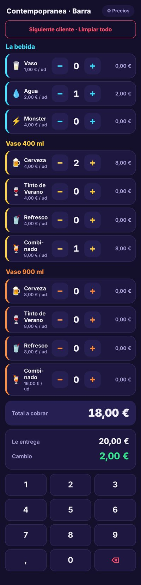
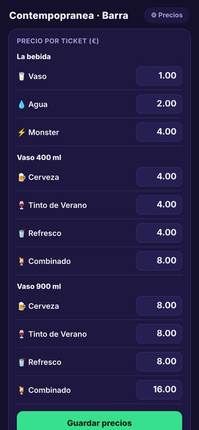

<div align="center">
  
</div>

<div align="center">
  <a href="https://github.com/evagr11/tpv-barra-festival"></a>
  <a href="https://evagr11.github.io/tpv-barra-festival/"></a>
</div>

<div align="center">
  <a href="https://git.io/typing-svg"></a>
</div>

# 🚀 Sobre el Proyecto

**TPV Barra Festival** es una aplicación web ligera y minimalista diseñada para actuar como un Terminal Punto de Venta (TPV) en la barra de un evento o festival. Permite llevar la cuenta de las bebidas vendidas, calcular el total de la compra y gestionar el cambio a devolver de forma rápida y eficiente, con una interfaz optimizada para su uso en dispositivos móviles.

La aplicación realiza todos los cálculos monetarios utilizando céntimos como unidad base (enteros) para **garantizar la máxima precisión** y evitar los errores de redondeo comunes al trabajar con números flotantes.

<br>

<div align="center">
  
  <p><em>Mockup TPV Barra Festival</em></p>
</div>

Ahora mismo está configurada con la carta de la barra del festival **Contempopranea** (Don Benito): vasos, agua, Monster y cerveza, tinto de verano, refresco y combinado en vasos de 400 y 900 ml.

✨ **Características principales:**

*   📱 **Interfaz Mobile-First:** Diseñada para parecer y funcionar como una app nativa en móviles, con botones grandes y fáciles de pulsar durante un evento concurrido.
*   🗂️ **Carta por categorías:** Los productos se agrupan por bloques con su color (bebidas sueltas, vaso de 400 ml y vaso de 900 ml). Toda la carta sale de un único array `PRODUCTOS` en `script.js`, así que adaptarla a otro evento es cambiar unas líneas.
*   ⚙️ **Precios Configurables:** Permite establecer y modificar los precios de cada producto desde la propia app. Los cambios se guardan localmente para que no sea necesario reconfigurarlos cada vez.
*   💰 **Cálculo de Cambio Preciso:** Incluye un teclado numérico tipo datáfono para introducir el importe entregado por el cliente y calcular el cambio exacto de forma instantánea.
*   💾 **Persistencia con `localStorage`:** Los precios se almacenan en el navegador del dispositivo, sobreviviendo a cierres de pestaña o reinicios.
*   🌐 **PWA con funcionamiento offline:** Se instala en la pantalla de inicio con su propio icono y un *service worker* guarda la app en el móvil, así que abre y funciona **aunque no haya cobertura**, incluso después de cerrarla. Ideal para recintos llenos de gente.
*   🔁 **Siguiente cliente:** Un botón vacía la venta para empezar la siguiente al momento, y si el dinero entregado no llega se avisa con "Falta dinero".
*   💡 **Cero Dependencias:** Construida con HTML, CSS y JavaScript puros (Vanilla JS), sin frameworks ni librerías externas, asegurando una carga ultrarrápida y máxima compatibilidad.

### Galería

| Venta en curso | Ajuste de precios |
| :------------: | :---------------: |
|  |  |
| *Total, importe entregado y cambio.* | *Precios editables, guardados en el móvil.* |

# 🧠 Contexto del Proyecto

Este es un **proyecto personal** creado a partir de una necesidad real: agilizar el proceso de cobro en la barra de un festival o evento. La idea era desarrollar una herramienta simple, rápida y fiable que pudiera usarse en un iPhone o cualquier otro smartphone como una "app", sin depender de conexión a internet y con una interfaz a prueba de errores.

# 🛠️ Stack Tecnológico
<div align="center">
  
  
  
  
</div>

<br>

<div align="center">

| Área | Tecnología |
| :--- | :--------- |
| **Frontend** | `HTML5`, `CSS3`, `JavaScript (ES6+)` |
| **Almacenamiento** | `localStorage` del navegador |
| **App** | `manifest.webmanifest` + `service worker` (instalable y sin conexión) |
| **Despliegue** | `GitHub Pages` |

</div>


# 📂 Estructura del Proyecto

El proyecto tiene una estructura muy sencilla: tres archivos para la app y tres más para que se pueda instalar y usar sin conexión.

```bash
.
├── index.html             # Estructura principal y contenido de la app
├── style.css              # Estilos visuales y diseño responsive
├── script.js              # Carta de productos, lógica y manejo de eventos
├── manifest.webmanifest   # Nombre, colores e iconos de la app instalada
├── sw.js                  # Service worker: guarda la app para usarla sin conexión
├── icons/                 # Iconos de la app
└── README.md
```

# 🚀 Cómo Utilizar el Proyecto

Al ser un proyecto estático sin dependencias, no requiere ningún proceso de compilación.

### 1. Despliegue en GitHub Pages (Recomendado)

La forma más sencilla de usar la aplicación es desplegarla gratuitamente con GitHub Pages:

1.  Haz un **fork** de este repositorio o crea un repositorio nuevo en tu cuenta de GitHub.
2.  Sube todos los archivos del proyecto (incluidos `manifest.webmanifest`, `sw.js` y la carpeta `icons/`) a la raíz del repositorio.
3.  En tu repositorio, ve a **Settings** > **Pages**.
4.  En la sección **Build and deployment**, selecciona la fuente (`Source`) como **Deploy from a branch**.
5.  Elige la rama `main` (o `master`) y la carpeta `/ (root)`. Haz clic en **Save**.
6.  Tras unos minutos, tu aplicación estará disponible en una URL como `https://tu-usuario.github.io/tu-repositorio/`.

### 2. Uso en el evento

1.  Abre la URL en el navegador de tu móvil (preferiblemente Safari en iPhone o Chrome en Android).
2.  Para una experiencia de "app nativa", utiliza la opción **"Añadir a pantalla de inicio"** de tu navegador. Esto creará un icono en tu móvil y abrirá la app a pantalla completa.
    > 📶 **Ábrela una vez con conexión antes del evento.** Así el móvil guarda la app y luego funciona aunque en el recinto no haya cobertura.
3.  Configura los precios tocando el botón **⚙︎ Precios**. Estos se guardarán para usos futuros.

### 3. Ejecución Local

Si quieres probarlo en tu ordenador:

1.  Clona el repositorio:
    ```bash
    git clone https://github.com/evagr11/tpv-barra-festival.git
    ```
2.  Navega a la carpeta del proyecto:
    ```bash
    cd tpv-barra-festival
    ```
3.  Abre el archivo `index.html` directamente en tu navegador.

<div align="center">
  
  <p><em>Panel para configurar los precios de cada tipo de ticket.</em></p>
</div>

---

<div align="center">
  <p>Creado por <strong>Eva Gallardo</strong></p>
  <a href="https://github.com/evagr11" target="_blank">
    
  </a>
  <a href="https://www.linkedin.com/in/eva-gallardo-romero-830362349/" target="_blank">
    
  </a>
</div>


<div align="center">
  
</div>